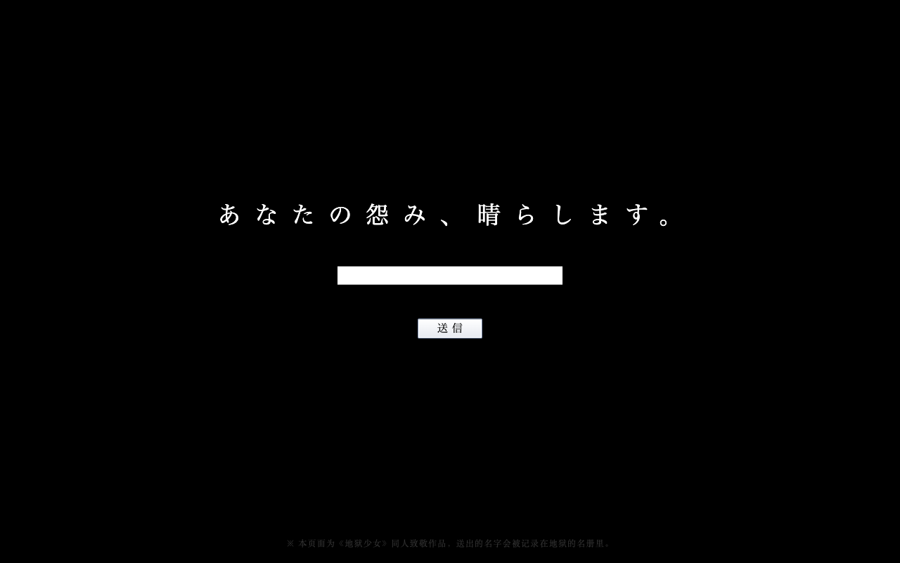
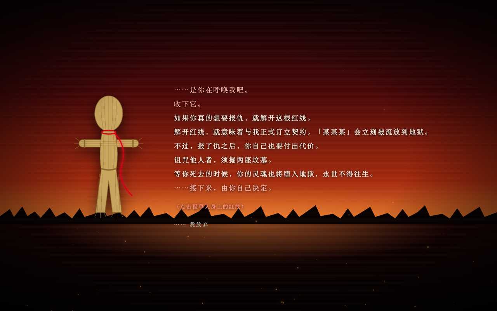
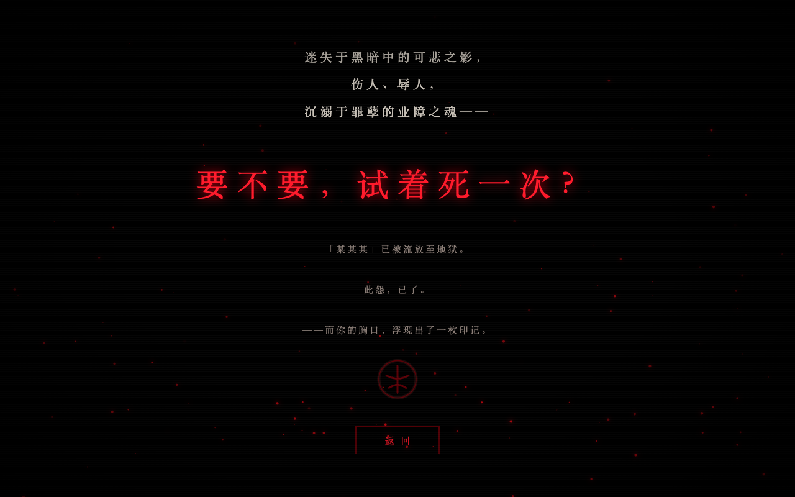

# 地獄通信

《地狱少女》里「地狱通信」网站的同人致敬页面。不用等到午夜零点，随时都能打开。

写下你所怨恨之人的名字并送信，阎魔爱会在黄昏之乡交给你一个系着红线的稻草人。解开红线，契约即成立——对方会被流放到地狱，而你死后也将堕入地狱。

送出的每一个名字，以及最后是解开了红线还是放弃了，都会记录在后端的「地狱名册」（SQLite）里。

> 本项目为非商业的同人致敬作品，《地狱少女》相关版权归原作者所有。

## 截图

| 开场火焰 | 送信 |
| --- | --- |
|  |  |
| **黄昏之乡** | **流放** |
|  |  |

## 流程

1. **开场**：黑暗中燃起一团火，摇曳片刻后化作残焰散去（点击可全屏）
2. **送信**：「あなたの怨み、晴らします。」，填写名字后点「送信」
3. **受理**：画面闪烁，「发送中……」「已受理。」
4. **黄昏之乡**：阎魔爱交出稻草人并说明契约内容，你可以解开红线，或者放弃
5. **流放**：「要不要，试着死一次？」对方被流放至地狱，你的胸口浮现出印记

## 技术栈

pnpm workspace 单仓，前后端共用一份类型和校验规则。

| 目录 | 说明 |
| --- | --- |
| `apps/web` | 前端：Vite + React 19 + TypeScript，CSS Modules |
| `apps/server` | 后端：Hono（Node）+ Drizzle ORM + SQLite（libsql） |
| `packages/shared` | 共享的类型定义与 zod 校验规则 |

前端每一幕是 `apps/web/src/scenes/` 下的一个组件，由 `App.tsx` 中的一个状态切换；逐字台词由 `useScript` hook 播放，切换场景时会自动中止。开场火焰和背景火星都是纯 Canvas 粒子动画，不依赖任何图片素材。

## 本地运行

需要 Node.js 22+ 和 pnpm 9+。

```bash
pnpm install
pnpm dev
```

- 前端：http://localhost:5173
- 后端：http://localhost:8787（前端开发服务器会把 `/api` 代理过去）

数据库文件默认在 `apps/server/data/jigoku.db`，启动时自动建表，无需单独安装数据库。

### 生产模式

```bash
pnpm build   # 构建前端
pnpm start   # 启动后端，同时托管前端页面，访问 http://localhost:8787
```

### 环境变量

| 变量 | 默认值 | 说明 |
| --- | --- | --- |
| `PORT` | `8787` | 后端端口 |
| `DATABASE_PATH` | `apps/server/data/jigoku.db` | SQLite 数据库文件路径 |

### 其他命令

```bash
pnpm typecheck     # 所有包的类型检查
pnpm db:generate   # 修改 apps/server/src/db/schema.ts 后生成新的迁移文件
```

## API

| 方法 | 路径 | 说明 |
| --- | --- | --- |
| `POST` | `/api/grudges` | 送信，body：`{ "targetName": "名字" }`（1～32 个字） |
| `POST` | `/api/grudges/:id/contract` | 解开红线，契约成立 |
| `POST` | `/api/grudges/:id/abandon` | 放弃 |
| `GET` | `/api/grudges` | 最近 100 条记录 |

每条记录的状态为 `pending`（已送信）、`contracted`（契约成立）或 `abandoned`（放弃）。一条怨恨只能了结一次：重复了结返回 `409`，记录不存在返回 `404`，名字不合法返回 `400`。
